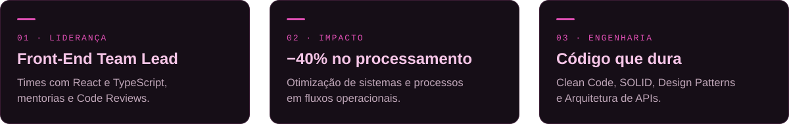
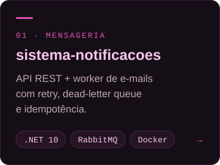
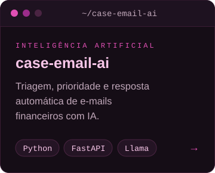
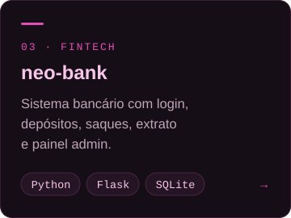

<!--
  GitHub Profile — Maria Eduarda (MaduSantoss)
  Tema: Soft Pink Dark ✿ | minimalista, rosa suave sobre fundo escuro
-->

  

   

  

## ✿ Sobre mim

Sou **Desenvolvedora de Software** com foco em **Back-End**, atuando com **C#** e **.NET** na construção de APIs, integrações e soluções orientadas a regras de negócio.

Minha trajetória passa por **Infraestrutura, Back-End, Front-End e Liderança Técnica** — e essa vivência me deu uma visão ampla de todo o ciclo de desenvolvimento: da concepção arquitetural até performance, observabilidade e cultura de time.

Meu próximo passo é me aprofundar em **arquitetura, cloud e sistemas escaláveis, resilientes e sustentáveis**.

## ✿ Destaques

## ✿ Tecnologias

<table>
  <tr>
    <td align="center"><samp>back-end</samp>  </td>
    <td align="center"><samp>dados</samp>   <samp>+ SQL Server</samp></td>
    <td align="center"><samp>devops &amp; cloud</samp>  </td>
    <td align="center"><samp>front-end</samp>  </td>
  </tr>
</table>

## ✿ Projetos

  
  
  

<a href="https://github.com/MaduSantoss?tab=repositories"><samp>ver todos os repositórios →</samp></a>

## ✿ Atividade

  
  

  

## ✿ Contato

  &nbsp;
  &nbsp;
  

